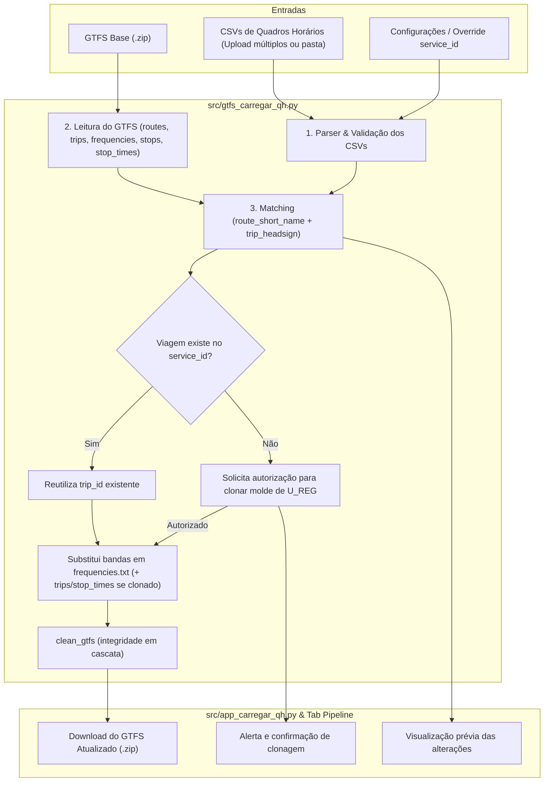

# Plano — Carregamento de Quadros de Horários (CSV) no GTFS

> **Status:** Elaborado em 17/11/2026 — Aguardando aprovação para execução  
> **Objetivo:** Criar aplicação Streamlit e módulo de backend para carregar arquivos CSV de quadros de horários (formato dos scripts `1.3` e `1.4`) em um arquivo GTFS (`.zip`), substituindo as programações existentes no GTFS.  
> **Operação inversa:** Enquanto o script `1.4` (e o `1`) extrai quadros de horários em CSV a partir de um GTFS, esta ferramenta faz o caminho oposto: ingere os CSVs e atualiza o `frequencies.txt` (e `trips.txt`/`stop_times.txt`, se necessário) do GTFS.

---

## 1. Contexto e Justificativa

No fluxo de trabalho da SMTR, ajustes operacionais e simulações de novas ordens de serviço (OS) são frequentemente definidos em nível de quadros de horários ou contagens por faixa (via script `1.3_qh_a_partir_de_partidas.py`).

Para que essas novas programações possam ser testadas, validadas com o validador oficial ou utilizadas no planejamento da rede, elas precisam ser incorporadas de volta a um GTFS existente. Como os CSVs de quadros de horários trazem `trip_id` em branco por design, a ferramenta precisa realizar a amarração inteligente entre as bandas horárias do CSV e as entidades do GTFS (`routes.txt`, `trips.txt`, `frequencies.txt` e `stop_times.txt`).

---

## 2. Decisões de Projeto (Alinhadas com o Usuário)

1. **Detecção do `service_id` (Tipo de Dia):**
   - **Automática:** O script analisa o sufixo do nome do arquivo CSV (padrão do script 1.3/1.4: `horarios_{servico}_{headsign}_{service_id}.csv`, identificando tokens como `F_REG`, `U_REG`, `S_REG`, `D_REG`, `F`, `U`, `S`, `D`, etc.).
   - **Fallback manual:** Na interface Streamlit, haverá um seletor manual de `service_id` padrão, aplicado caso o nome do arquivo não contenha o token ou caso o usuário deseje forçar um tipo de dia específico.

2. **Escopo da Substituição (por Sentido / Headsign):**
   - Cada arquivo CSV representa um sentido específico da linha.
   - A substituição atua **apenas no sentido/headsign e calendário (`service_id`) indicados no CSV**, preservando integralmente o sentido oposto e os demais calendários já cadastrados no GTFS.
   - As bandas antigas correspondentes a `(route_id, trip_headsign, service_id)` em `frequencies.txt` são removidas e substituídas pelas novas bandas do CSV.

3. **Mapeamento de Viagens (`trip_id`) e Estratégia de Clonagem:**
   - **Caso Normal (Viagem molde já existe no GTFS para o `service_id`):** O script localiza o `trip_id` cadastrado para `(route_id, service_id, trip_headsign)` e associa as novas bandas de frequência a esse `trip_id`.
   - **Caso Novo (Não existe viagem cadastrada para esse `service_id`, ex.: criando `F_REG` para linha que só tinha `U_REG`):**
     - O sistema detecta a ausência e seleciona uma viagem molde da mesma linha e sentido em outro calendário base (prioridade: `U_REG` $\rightarrow$ `S_REG` $\rightarrow$ `D_REG`).
     - **Confirmação Obrigatória:** O app avisa explicitamente ao usuário na interface que será necessária a clonagem de viagem (listando quais linhas/sentidos serão afetados) e exige permissão explícita (caixa de confirmação / botão) antes de realizar a clonagem em `trips.txt` e `stop_times.txt`.
     - Ao clonar, gera um novo `trip_id` derivado, vincula ao novo `service_id`, copia a sequência de paradas em `stop_times.txt` e cria as bandas correspondentes em `frequencies.txt`.

---

## 3. Arquitetura da Solução

---

## 4. Estrutura dos Arquivos a Criar e Modificar

1. **`src/gtfs_carregar_qh.py` (Módulo de Lógica Pura):**
   - Funções isoladas da interface:
     - `parse_qh_csv(filepath_or_buffer, fallback_service_id=None)`: extrai `servico`, `headsign`, `service_id` e bandas (`start_time`, `end_time`, `headway_secs`).
     - `detectar_alteracoes(gtfs_dict, lista_qh)`: analisa o que será substituído e quais linhas precisam de clonagem de viagem molde.
     - `aplicar_quadros_gtfs(gtfs_dict, lista_qh, permitir_clonagem=False)`: aplica a substituição em `frequencies.txt`, clona trips/stop_times se autorizado e roda `clean_gtfs()`.
     - `salvar_gtfs_zip(gtfs_dict, caminho_saida_ou_bytes)`: exporta o arquivo `.zip` resultante.

2. **`src/app_carregar_qh.py` (Aplicação Streamlit Standalone):**
   - Upload do GTFS `.zip` (ou seleção de caminho local em `C:/R_SMTR/dados/gtfs/`).
   - Upload de múltiplos CSVs de quadros horários (ou seleção de pasta local).
   - Campo para definir `service_id` manual caso não conste no nome do arquivo.
   - Tabela de resumo pré-processamento:
     - Linha, Vista/Headsign, Calendário, Total de Bandas, Total de Partidas Calculadas.
     - Status: `Substituição direta` ou `Requer clonagem de molde`.
   - Card de aviso e confirmação para clonagem (quando houver novas trips).
   - Botão para processar e botão nativo de download do GTFS resultante (`.zip`).

3. **`codigos_py/1.5_carregar_qh_no_gtfs.py` (Script CLI):**
   - Script executável pelo terminal com suporte a `--config` JSON (seguindo o padrão dos scripts 1.1–1.4 do repositório), permitindo automação via batch ou agendamento.

4. **`tests/test_gtfs_carregar_qh.py` (Testes Unitários Automatizados):**
   - Criação de GTFS sintético em memória.
   - Teste de substituição de frequência em viagem existente.
   - Teste de clonagem com novo `service_id`.
   - Teste de garantia de que o sentido oposto não é modificado.
   - Teste de consistência do validador de integridade (`clean_gtfs`).

5. **Documentação:**
   - Atualização de `AGENTS.md`, `README.md`, `CHANGELOG.md` e `.opencode/memory.md`.

---

## 5. Casos de Borda e Validações de Segurança

- **Headsign ligeiramente diferente:** Caso o `trip_headsign` do CSV tenha variação de maiúsculas/espaços em relação ao GTFS, aplicar normalização insensível a maiúsculas/minúsculas e pontuação.
- **Bandas inválidas no CSV:** Rejeitar bandas com `headway_secs <= 0` ou `end_time <= start_time`.
- **Linha inexistente no GTFS:** Se o `trip_short_name` do CSV não existir em `routes.txt`, alertar o usuário com erro claro antes de iniciar qualquer modificação.
- **Preservação de viagens regulares sem frequências:** Se o GTFS possuir viagens programadas por `stop_times.txt` individual (sem frequências), garantir que apenas as viagens associadas às frequências daquela linha/sentido sejam substituídas.

---

## 6. Próximos Passos para Execução

1. [ ] Gravação deste plano no arquivo [PLANO_CARREGAR_QH_NO_GTFS.md](file:///c:/github_repositories/processar_gtfs/PLANO_CARREGAR_QH_NO_GTFS.md).
2. [ ] Implementação do módulo puro `src/gtfs_carregar_qh.py`.
3. [ ] Criação dos testes unitários em `tests/test_gtfs_carregar_qh.py` e validação com `python -m unittest`.
4. [ ] Implementação da aplicação Streamlit `src/app_carregar_qh.py` e do script CLI `codigos_py/1.5_carregar_qh_no_gtfs.py`.
5. [ ] Atualização dos arquivos de controle e memória (`AGENTS.md`, `CHANGELOG.md`, etc.).
