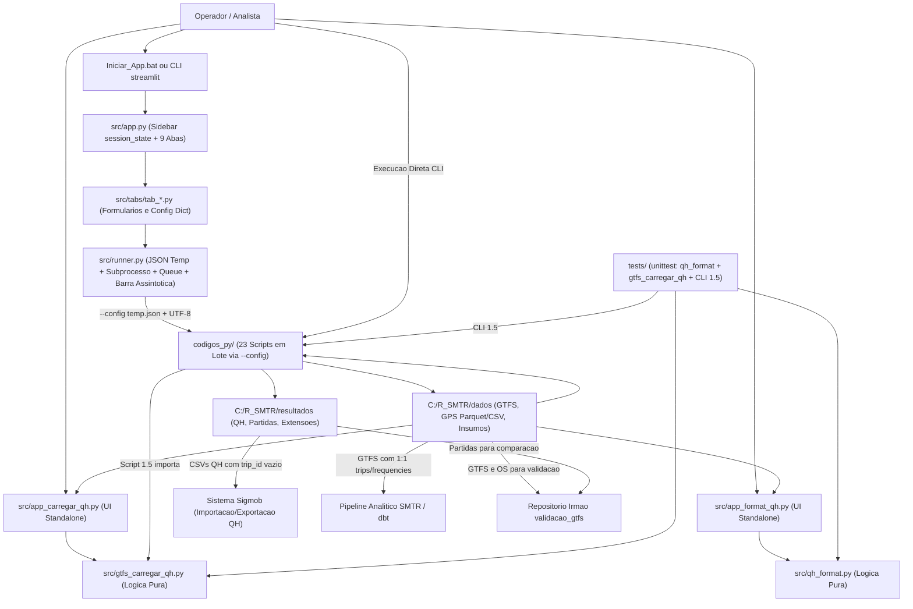

# Arquitetura do Sistema (`processar_gtfs`)

Este documento descreve a organização técnica, os componentes, o fluxo de comunicação, as integrações externas e as decisões arquiteturais do pipeline de processamento de dados **GTFS** (*General Transit Feed Specification*) da Secretaria Municipal de Transportes do Rio de Janeiro (**SMTR**).

Para a sequência operacional das etapas, consulte [pipeline.md](./pipeline.md). Para o catálogo completo de arquivos, consulte [scripts_reference.md](./scripts_reference.md).

---

## Índice

- [1. Organização Geral do Sistema](#1-organização-geral-do-sistema)
  - [1.1. Camada de Interface e Orquestração (`src/`)](#11-camada-de-interface-e-orquestração-src)
  - [1.2. Aplicações Streamlit Standalone e Módulos de Lógica Pura](#12-aplicações-streamlit-standalone-e-módulos-de-lógica-pura)
  - [1.3. Camada de Processamento em Lote (`codigos_py/`)](#13-camada-de-processamento-em-lote-codigos_py)
  - [1.4. Suíte de Testes (`tests/`)](#14-suíte-de-testes-tests)
  - [1.5. Legado R e Materiais de Apoio](#15-legado-r-e-materiais-de-apoio)
- [2. Fluxo de Comunicação entre Componentes](#2-fluxo-de-comunicação-entre-componentes)
- [3. Diagrama de Arquitetura](#3-diagrama-de-arquitetura)
- [4. Integrações Externas e Ecossistema](#4-integrações-externas-e-ecossistema)
- [5. Decisões Arquiteturais e Invariantes Técnicas](#5-decisões-arquiteturais-e-invariantes-técnicas)
- [6. Padrões de Organização e Nomenclatura](#6-padrões-de-organização-e-nomenclatura)

---

## 1. Organização Geral do Sistema

O repositório adota uma arquitetura em camadas desacoplada por processo: a interface web em **Streamlit** coleta parâmetros e orquestra a execução de scripts Python independentes em subprocessos, enquanto operações interativas de Quadros de Horários (**QH**) utilizam módulos de lógica pura compartilhados entre interface web e linha de comando (**CLI**).

### 1.1. Camada de Interface e Orquestração (`src/`)

- [`src/app.py`](../src/app.py): ponto de entrada da interface web principal. Configura a barra lateral (*sidebar*) com parâmetros globais compartilhados via `st.session_state` (`BASE_DADOS`, `ano_gtfs`, `mes_gtfs`, `estudo_gtfs`, `gtfs_processar`) e organiza o pipeline em **9 abas** com importação preguiçosa (*lazy loading*).
- [`src/runner.py`](../src/runner.py): motor de execução de subprocessos (`run_script`). Isola o processo dos scripts em lote da sessão Streamlit, garantindo captura em tempo real de logs e progresso visual.
- [`src/tabs/`](../src/tabs/): contém os 9 módulos de abas, mapeados às etapas ativas do pipeline:
  - [`tab_1_extrair_qh.py`](../src/tabs/tab_1_extrair_qh.py) — modos `1`, `1.1`, `1.2`, `1.3`, `1.3.1`, `1.4` e `1.5`.
  - [`tab_2_ajustar_st.py`](../src/tabs/tab_2_ajustar_st.py) — script `2`.
  - [`tab_4_trajetos.py`](../src/tabs/tab_4_trajetos.py) — script `4`.
  - [`tab_5_juntar.py`](../src/tabs/tab_5_juntar.py) — modos `5`, `5.1`, `5.2`, `5.3` e `5.4`.
  - [`tab_6_shapes.py`](../src/tabs/tab_6_shapes.py) — script `6`.
  - [`tab_7_partidas.py`](../src/tabs/tab_7_partidas.py) — modos `7`, `7.1` e `7.2`.
  - [`tab_8_extensoes.py`](../src/tabs/tab_8_extensoes.py) — modos `8` e `8.1`.
  - [`tab_9_filtrar.py`](../src/tabs/tab_9_filtrar.py) — script `9`.
  - [`tab_10_juntar_dois.py`](../src/tabs/tab_10_juntar_dois.py) — script `10`.

> A etapa `3` ([`3_desvios_nao-utilizar.py`](../codigos_py/3_desvios_nao-utilizar.py)) é descontinuada e não possui aba na interface. Os antigos scripts da família `11` foram migrados para o repositório irmão `validacao_gtfs`.

### 1.2. Aplicações Streamlit Standalone e Módulos de Lógica Pura

Funcionalidades interativas de análise e carga de Quadros de Horários separam estritamente a camada de apresentação (**UI**) da regra de negócio (lógica pura sem dependência de Streamlit), viabilizando testes unitários automatizados e reúso em CLI:

| Aplicação UI | Módulo de Lógica Pura | Finalidade e Reúso |
|---|---|---|
| [`src/app_format_qh.py`](../src/app_format_qh.py) | [`src/qh_format.py`](../src/qh_format.py) | Versão Python do legado Shiny (`1.2 app_format_qh.R`). Faz upload de GTFS, seleção em cascata (linha, sentido, calendário, destino), compara programação prevista colada pelo usuário com o GTFS, exibe resumo por faixa e exporta o QH em CSV. |
| [`src/app_carregar_qh.py`](../src/app_carregar_qh.py) | [`src/gtfs_carregar_qh.py`](../src/gtfs_carregar_qh.py) | Carrega CSVs de QH (formato dos scripts `1.3`/`1.4`) em um GTFS base, substituindo frequências por sentido e calendário, com pré-visualização de alterações e clonagem de viagem molde sob confirmação explícita. O módulo [`src/gtfs_carregar_qh.py`](../src/gtfs_carregar_qh.py) é importado diretamente pelo script CLI [`codigos_py/1.5_carregar_qh_no_gtfs.py`](../codigos_py/1.5_carregar_qh_no_gtfs.py). |

### 1.3. Camada de Processamento em Lote (`codigos_py/`)

Reúne **23 scripts Python** numerados de `1` a `10` e variantes (`1.1` a `1.5`, `5.1` a `5.4`, `7.1`, `7.2`, `8.1`). Cada script pode ser executado diretamente via terminal/IDE ou invocado pelo `src/runner.py` com `--config <arquivo.json>`.

- **Ativos (21 scripts):** cobrem extração/combinação/geração/conferência/carga de QH, ajuste de `stop_times` por GPS, relatório de trajetos alternativos, junção/substituição/deduplicação de GTFS, exportação geoespacial, geração/combinação de partidas, cálculo de extensões e filtragem/junção por lista.
- **Descontinuado (1 script):** [`codigos_py/3_desvios_nao-utilizar.py`](../codigos_py/3_desvios_nao-utilizar.py) — obsoleto, substituído por `4_trajetos_alternativos.py`.
- **Com ressalva (1 script):** [`codigos_py/7.1_resumo_os_domingo_du.py`](../codigos_py/7.1_resumo_os_domingo_du.py) — mantido apenas como referência e marcado para evitar por erros conhecidos.

### 1.4. Suíte de Testes (`tests/`)

Utiliza a biblioteca padrão `unittest` (detalhes em [testing.md](./testing.md)):

- [`tests/test_qh_format.py`](../tests/test_qh_format.py): testes unitários sobre a lógica pura de [`src/qh_format.py`](../src/qh_format.py).
- [`tests/test_gtfs_carregar_qh.py`](../tests/test_gtfs_carregar_qh.py): testes unitários de [`src/gtfs_carregar_qh.py`](../src/gtfs_carregar_qh.py) e testes de integração CLI de [`codigos_py/1.5_carregar_qh_no_gtfs.py`](../codigos_py/1.5_carregar_qh_no_gtfs.py).

### 1.5. Legado R e Materiais de Apoio

- [`codigos_R/`](../codigos_R/): implementações anteriores do pipeline em R (`0.0` a `7`, além de utilitários de conversão RDS/Parquet) e subdiretório [`codigos_R/datados/`](../codigos_R/datados/) com scripts obsoletos preservados apenas para referência histórica.
- [`nota_tecnica_avaliacao_quadros/`](../nota_tecnica_avaliacao_quadros/): documentação metodológica e planilhas de simulação para avaliação de quadros horários, capacidade tecnológica e cálculo de frota (`NOTA_TECNICA_AVALIACAO_QUADROS_HORARIOS.md`, `.docx`, `.pdf` e anexos).

---

## 2. Fluxo de Comunicação entre Componentes

A execução pela interface gráfica segue um ciclo determinístico de isolamento por subprocesso:

1. **Inicialização:** o usuário executa [`Iniciar_App.bat`](../Iniciar_App.bat) (que ativa `.venv\Scripts\activate.bat` e chama `python -m streamlit run src/app.py`) ou invoca diretamente `python -m streamlit run src/app.py`.
2. **Estado global e roteamento:** [`src/app.py`](../src/app.py) renderiza a sidebar e persiste os parâmetros globais em `st.session_state`. Cada aba em `src/tabs/tab_*.py` é carregada via *lazy loading* e lê esses valores como defaults de seus formulários.
3. **Serialização da configuração:** ao acionar a execução, a aba monta um dicionário `config` e chama `run_script(script_path, config)` em [`src/runner.py`](../src/runner.py). O runner grava o dicionário em um arquivo JSON temporário (`tempfile.NamedTemporaryFile(..., suffix=".json", encoding="utf-8")`).
4. **Execução do subprocesso:** `run_script` dispara `subprocess.Popen([sys.executable, script_path, "--config", config_file])`, reutilizando o mesmo interpretador Python do ambiente virtual e forçando `PYTHONIOENCODING="utf-8"` no ambiente do processo filho (evitando falhas de codificação `cp1252` no Windows com caracteres box-drawing e acentos).
5. **Streaming assíncrono de logs e progresso:** uma *thread daemon* lê linhas de `stdout` (com `stderr` redirecionado para `STDOUT`) e as enfileira em um `queue.Queue` terminando com uma sentinela `_EOF`. O loop principal consulta a fila com timeout de `0.3s`, atualizando uma barra de progresso assintótica baseada no tempo decorrido (`cap = 0.95`, `tau = 90.0s`, chegando a `100%` apenas em `return_code == 0`) e exibindo janela deslizante das últimas **500 linhas** de log.
6. **Limpeza garantida:** no bloco `finally`, o arquivo JSON temporário é removido do disco (`os.remove(config_file)`), independentemente de sucesso ou falha.

---

## 3. Diagrama de Arquitetura

---

## 4. Integrações Externas e Ecossistema

O `processar_gtfs` opera integrado a sistemas operacionais, analíticos e a um repositório complementar de validação:

- **Sistema Sigmob:** sistema de gestão de mobilidade utilizado pela SMTR para cadastro de quadros horários. Os CSVs gerados pelos scripts `1`, `1.2`, `1.3`, `1.4` e pelo app `app_format_qh.py` são formatados para importação direta no Sigmob, mantendo a coluna `trip_id` propositalmente vazia para ser preenchida pelo próprio Sigmob no momento do salvamento.
- **Pipeline Analítico SMTR / dbt:** o modelo analítico `viagem_planejada_planejamento` impõe o teste de integridade `unique: [feed_start_date, id_viagem]`. Para compatibilidade com esse modelo, a carga de QH no GTFS (`1.5` e `app_carregar_qh.py`) mantém estritamente a relação 1:1 entre viagens (`trips.txt`) e faixas (`frequencies.txt`).
- **Projeto irmão `validacao_gtfs` (`C:\github_repositories\validacao_gtfs`):** repositório independente com versionamento próprio responsável pela validação de entrada, validação pós-pipeline e comparações. Recebeu os antigos scripts da família `11` e agrupa:
  - `0_validar_gtfs_entrada.py` (validação pré-pipeline);
  - `1_validar_gtfs.py` (validação pós-pipeline);
  - `2_comparar_os_gtfs.py` (comparação de partidas OS × GTFS);
  - `3_comparar_duas_os.py` (comparação entre duas OS "Resumo por Dia");
  - `4_comparar_dois_gtfs.py` (comparação entre dois arquivos GTFS com extensão GIS).
- **Insumos externos em `C:/R_SMTR/dados`** (detalhados em [configuration.md](./configuration.md) e [data_dictionary.md](./data_dictionary.md)):
  - Viagens GPS reais em formato Parquet (SPPO e Rio) e CSV (BRT e Frescão), consumidas pela etapa `2`;
  - `calendario.json` (feriados e classificação de tipos de dia para cálculo de velocidades);
  - `insumos/gtfs_cores.csv` (paleta `route_color` e `route_text_color` aplicada na geração do GTFS público);
  - `insumos/gtfs_combi/` e `insumos/gtfs_pub/` (arquivos institucionais de substituição como `calendar_dates.txt`, `fare_attributes.txt`, `fare_rules.txt` e `feed_info.txt`, com suporte a subpastas por etapa no modal Rio);
  - `insumos/trip_id_fantasma.txt` (lista de `trip_id` a descartar nas etapas `5`, `5.1` e `7`);
  - `insumos_desvios/` (tabelas auxiliares de desvios usadas por `6_gerar_shapes.py` como `descricao_desvios.csv` opcional e pelo script descontinuado `3`).

---

## 5. Decisões Arquiteturais e Invariantes Técnicas

As decisões abaixo governam o comportamento do código e devem ser preservadas em qualquer manutenção:

1. **Contrato dual de configuração (`--config` + defaults no topo):** todos os scripts ativos aceitam `--config <arquivo.json>` via `argparse.parse_known_args()`. Na ausência do argumento, utilizam as variáveis *hardcoded* no topo do arquivo, preservando retrocompatibilidade para execução avulsa via terminal ou IDE.
2. **Leitura defensiva com `dtype=str`:** as tabelas `.txt` dos arquivos GTFS são lidas como texto (`pd.read_csv(..., dtype=str)`) na maioria dos scripts para evitar a corrupção de códigos alfanuméricos, perda de zeros à esquerda (ex.: linha `006`, `007`) e inferência incorreta de tipos mistos.
3. **Limpeza em cascata (`clean_gtfs()`):** implementada nos scripts de junção, filtragem, deduplicação e carga (`5`, `5.1`, `5.3`, `5.4`, `9`, `10`, `src/gtfs_carregar_qh.py`), reproduz o comportamento de `gtfstools::filter_by_trip_id` do R. A partir das viagens válidas em `trips.txt`, remove registros órfãos em cascata de `stop_times`, `frequencies`, `routes`, `shapes`, `stops`, `calendar`, `calendar_dates` e `agency`.
4. **Invariante 1:1 entre `trips.txt` e `frequencies.txt` (`1.5` e `app_carregar_qh.py`):** cada banda horária gravada em `frequencies.txt` recebe um `trip_id` exclusivo (gerado via UUID) em `trips.txt` e uma cópia correspondente em `stop_times.txt` com os horários deslocados para que o `departure_time` da primeira parada coincida com o `start_time` da banda. Isso garante a aprovação no teste `unique: [feed_start_date, id_viagem]` do dbt.
5. **`trip_id` vazio por design nos CSVs de QH:** os arquivos `horarios_*.csv` exportados por `1`, `1.2`, `1.3`, `1.4` e `app_format_qh.py` mantêm a coluna `trip_id` em branco intencionalmente, conforme exigido pelo fluxo de importação no Sigmob.
6. **Regra única de extensão GIS (scripts `7`, `8` e `8.1`):** a extensão de cada itinerário é calculada geometricamente a partir de `shapes.txt` convertidos em `LineString`, projetados em **EPSG:31983** (SIRGAS 2000 / UTM zona 23S) e truncados para inteiro em metros (`astype(int)`), tomando o **máximo por itinerário** e **excluindo viagens `EXCEP` e desvios** (`[` no `trip_headsign`). Esse critério evita inflação por shapes de exceção e reproduz o histórico do Sigmob (que fica ~21 m abaixo de `shape_dist_traveled`). Os scripts `8` e `8.1` filtram `route_type` em `[3, 700]` (listagem SPPO), enquanto o script `7` não restringe `route_type` no cálculo de extensão para cobrir o modal BRT (`702`).
7. **Escrita ZIP sem compressão (`ZIP_STORED`):** os scripts que geram arquivos GTFS grandes gravam o pacote ZIP com `zipfile.ZIP_STORED` para evitar erros de memória/zlib na escrita de `stop_times.txt` extensos.

---

## 6. Padrões de Organização e Nomenclatura

Os artefatos do pipeline seguem convenções rígidas que conectam automaticamente as saídas de uma etapa às entradas da etapa seguinte (mais detalhes em [data_dictionary.md](./data_dictionary.md)):

| Categoria | Padrão de Nomenclatura | Descrição |
|---|---|---|
| GTFS bruto por modal | `{modal}_{YYYY}-{MM}-{NN}Q.zip` | Feed original antes do ajuste por GPS (`modal` em `sppo`, `brt`, `rio`). O sufixo `{NN}Q` identifica o número do estudo/quinzena. |
| GTFS processado (Etapa 2) | `{modal}_{YYYY}-{MM}-{NN}Q_PROC.zip` | Feed com `stop_times.txt` recalculado por velocidades GPS e `routes.txt` ajustado. |
| GTFS combinado interno (Etapas 5 / 5.1) | `gtfs_combi_{YYYY}-{MM}-{NN}Q.zip` | Feed unificado interno, preservando viagens regulares e `EXCEP`. |
| GTFS público (Etapas 5 / 5.1) | `gtfs_rio-de-janeiro_pub.zip` | Feed destinado à publicação externa, sem viagens `EXCEP` e com cores de `gtfs_cores.csv`. |
| GTFS filtrado / combinado auxiliar (Etapas 9 / 10) | `sppo_{YYYY}-{MM}-{NN}Q_FILTRADO.zip` e `sppo_{YYYY}-{MM}-{NN}Q_COMBINADO.zip` | Produtos do subfluxo de isolamento e reinserção de excepcionalidades. |
| Quadro Horário CSV (Etapa 1) | `horarios_{servico}_{headsign}_{service_id}.csv` | Arquivo por linha, sentido (`trip_headsign` sanitizado) e calendário. |
| Identificadores de calendário (`service_id`) | `U_REG`, `S_REG`, `D_REG`, `F_REG`, `EXCEP` | Respectivamente: Dia Útil, Sábado, Domingo, Ponto Facultativo e Excepcionalidade/Desvio. |
| Tags de desvio em `trip_headsign` | `[evento]` (ex.: `[desvio_feira]`, `[desvio_obras]`) | Marcador usado para identificar viagens de desvio em `4`, `5.4`, `7`, `8`, `8.1` e `9`. |

---

## Documentação Relacionada

- [Visão geral do projeto (`README.md`)](../README.md)
- [Fluxo do pipeline (`pipeline.md`)](./pipeline.md)
- [Catálogo de scripts (`scripts_reference.md`)](./scripts_reference.md)
- [Configurações e parâmetros (`configuration.md`)](./configuration.md)
- [Dicionário de dados e artefatos (`data_dictionary.md`)](./data_dictionary.md)
- [Testes e validação (`testing.md`)](./testing.md)
- [Solução de problemas (`troubleshooting.md`)](./troubleshooting.md)
