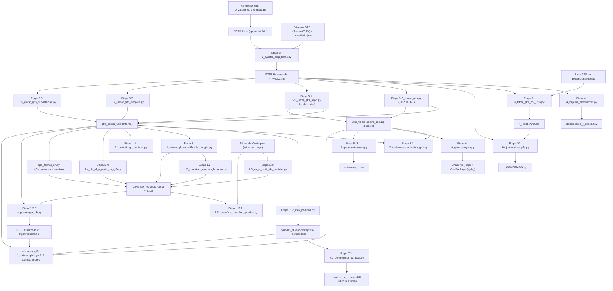

# Fluxo do Pipeline (`processar_gtfs`)

Este documento detalha a ordem de execução, a classificação das etapas, as entradas, as saídas, as dependências e os critérios de reprocessamento do pipeline de dados **GTFS** da **SMTR**.

Para compreender a arquitetura interna e as invariantes técnicas do projeto, consulte [architecture.md](./architecture.md). Para detalhes de cada parâmetro de configuração, consulte [configuration.md](./configuration.md).

---

## Índice

- [1. Classificação das Etapas](#1-classificação-das-etapas)
- [2. Diagrama Completo do Pipeline](#2-diagrama-completo-do-pipeline)
- [3. Fluxo Principal (Geração do GTFS Combinado/Público e Produtos Derivados)](#3-fluxo-principal-geração-do-gtfs-combinadopúblico-e-produtos-derivados)
- [4. Fluxo de Quadros de Horários (QH — Etapa 1 e Apps Standalone)](#4-fluxo-de-quadros-de-horários-qh--etapa-1-e-apps-standalone)
- [5. Fluxos Auxiliares, Alternativos e Independentes](#5-fluxos-auxiliares-alternativos-e-independentes)
- [6. Etapas Descontinuadas ou com Ressalva](#6-etapas-descontinuadas-ou-com-ressalva)
- [7. Pontos de Entrada e Possibilidade de Reprocessamento](#7-pontos-de-entrada-e-possibilidade-de-reprocessamento)

---

## 1. Classificação das Etapas

O pipeline é composto por **23 scripts em lote** em [`codigos_py/`](../codigos_py/) e **2 aplicações Streamlit standalone** em [`src/`](../src/), distribuídos em quatro categorias operacionais:

- **Fluxo Principal (obrigatório na publicação de GTFS e derivados):**
  - Etapa `2` (ajuste de `stop_times` por GPS) → Etapa `5` (junção SPPO + BRT) ou `5.1` (modal único: SPPO, BRT ou Rio) → Etapas independentes de derivação `6` (shapes GIS), `7` (lista de partidas) e `8` (extensões).
- **Fluxo de Quadros de Horários (QH — Etapa 1):**
  - Extração de faixas (`1`), extração de partidas detalhadas (`1.1`), combinação de quadros por janela horária (`1.2`), geração de QH a partir de contagens (`1.3`) + auditoria independente (`1.3.1`), geração de ponto facultativo a partir do GTFS (`1.4`), carga de QH CSV de volta no GTFS (`1.5`), além dos apps interativos [`src/app_format_qh.py`](../src/app_format_qh.py) e [`src/app_carregar_qh.py`](../src/app_carregar_qh.py).
- **Fluxos Auxiliares, Alternativos e Independentes:**
  - Etapa `4` (relatório de trajetos alternativos/desvios); variantes de junção e higiene `5.2` (concatenar simples), `5.3` (junção com substituição por linha) e `5.4` (eliminar duplicatas preservando `EXCEP`); pós-processamento `7.2` (combinar partidas DU + Dom) e `8.1` (extensões no formato `rio_YYYY-MM.zip`); subfluxo de excepcionalidades Etapa `9` (filtrar por lista) → Etapa `10` (juntar dois GTFS por chave primária).
- **Etapas Descontinuadas ou com Ressalva:**
  - Etapa `3` ([`3_desvios_nao-utilizar.py`](../codigos_py/3_desvios_nao-utilizar.py)) — **descontinuado**, não utilizar.
  - Etapa `7.1` ([`7.1_resumo_os_domingo_du.py`](../codigos_py/7.1_resumo_os_domingo_du.py)) — **evitar**, mantido apenas como referência devido a erros conhecidos.

> **Handoff de validação:** a validação pré-pipeline (`0_validar_gtfs_entrada.py`), a validação pós-pipeline (`1_validar_gtfs.py`) e os comparadores de OS/GTFS (`2_comparar_os_gtfs.py`, `3_comparar_duas_os.py`, `4_comparar_dois_gtfs.py`) residem no repositório irmão independente `C:\github_repositories\validacao_gtfs`.

---

## 2. Diagrama Completo do Pipeline

---

## 3. Fluxo Principal (Geração do GTFS Combinado/Público e Produtos Derivados)

Estas etapas constituem o caminho padrão de produção do GTFS combinado, do GTFS público e dos artefatos de publicação (shapes, partidas e extensões).

| Etapa | Script | Objetivo | Entradas | Saídas | Dependências | Execução |
|---|---|---|---|---|---|---|
| **2** (Obrigatória) | [`codigos_py/2_ajustar_stop_times.py`](../codigos_py/2_ajustar_stop_times.py) | Recalcular `arrival_time` e `departure_time` em `stop_times.txt` usando velocidades reais de GPS (com remoção de outliers via IQR) e garantir monotonicidade sem horários vazios. | GTFS bruto `{modal}_{sufixo}.zip` (`sppo`, `brt` ou `rio`), viagens GPS (Parquet para SPPO/Frescão; CSV para BRT) e `calendario.json`. | `{modal}_{sufixo}_PROC.zip` (com `stop_times.txt` e `routes.txt` atualizados). | Nenhuma etapa anterior neste repositório (opcionalmente validado antes em `validacao_gtfs/0_validar_gtfs_entrada.py`). | CLI: `python codigos_py/2_ajustar_stop_times.py --config <config.json>` \| App: **Aba 2 (`2. Ajustar ST`)**. |
| **5** (Obrigatória — SPPO + BRT) | [`codigos_py/5_juntar_gtfs.py`](../codigos_py/5_juntar_gtfs.py) | Combinar SPPO e BRT processados, ajustar `route_type`/`service_id`, remover trips fantasma e paradas `APAGAR`, aplicar limpeza `clean_gtfs()`, substituir insumos e gerar feed público com cores. | `sppo_{sufixo}_PROC.zip`, `brt_{sufixo}_PROC.zip`, `insumos/trip_id_fantasma.txt`, `insumos/gtfs_cores.csv`, `insumos/gtfs_combi/` e `insumos/gtfs_pub/`. | `gtfs_combi_{sufixo}.zip`, `gtfs_rio-de-janeiro_pub.zip` e **sobrescrita in-place** de `brt_{sufixo}_PROC.zip`. | Etapa `2` executada para SPPO e BRT. | CLI: `python codigos_py/5_juntar_gtfs.py --config <config.json>` \| App: **Aba 5 → modo `5. Juntar SPPO + BRT`**. |
| **5.1** (Alternativa à Etapa 5 — Modal Único) | [`codigos_py/5.1_juntar_gtfs_sppo.py`](../codigos_py/5.1_juntar_gtfs_sppo.py) | Processar e publicar um único modal (`sppo`, `brt` ou `rio`) sem combinação entre modais, com suporte a múltiplas etapas (`etapa_gtfs_rio`) nos insumos de substituição. | Um único `{modal}_{sufixo}_PROC.zip` + insumos (`trip_id_fantasma.txt`, `gtfs_cores.csv`, pastas `gtfs_combi` e `gtfs_pub` por etapa). | `gtfs_combi_{sufixo}.zip` e `gtfs_rio-de-janeiro_pub.zip`. | Etapa `2` executada para o modal alvo. | CLI: `python codigos_py/5.1_juntar_gtfs_sppo.py --config <config.json>` \| App: **Aba 5 → modo `5.1 Juntar Único`**. |
| **6** (Derivação GIS) | [`codigos_py/6_gerar_shapes.py`](../codigos_py/6_gerar_shapes.py) | Gerar camadas geoespaciais de trajetos (`LineString`) e pontos de parada (`Point`) projetados em EPSG:31983, enriquecidos com consórcio, tipo de rota, tarifas e descrição de desvios. | `gtfs_rio-de-janeiro_pub.zip` e opcionalmente `descricao_desvios.csv`. | Em `dados/shapes/{ano}/`: `shapes_trajetos_{sufixo}.shp`/`.gpkg` e `shapes_pontos_{sufixo}.shp`/`.gpkg`. | Etapa `5` ou `5.1` (qualquer GTFS válido com `shapes.txt` e `stops.txt`). | CLI: `python codigos_py/6_gerar_shapes.py --config <config.json>` \| App: **Aba 6 (`6. Shapes`)**. |
| **7** (Derivação de Partidas) | [`codigos_py/7_lista_partidas.py`](../codigos_py/7_lista_partidas.py) | Expandir frequências e viagens regulares por tipo de dia (`du`, `sab`, `dom`, `pf`), filtrar frescões e trips fantasma, calcular intervalos e extensões GIS (EPSG:31983, sem `EXCEP`/desvio, cobrindo BRT `702`). | `gtfs_combi_{sufixo}.zip` (ou outro GTFS especificado em `endereco_gtfs`) e `insumos/trip_id_fantasma.txt`. | Em `resultados/partidas/`: `partidas_du.csv`, `partidas_sab.csv`, `partidas_dom.csv`, `partidas_pf.csv` e consolidados `partidas_{sufixo}.csv`/`.parquet`. | Etapa `5` ou `5.1` (ou GTFS combinado equivalente). | CLI: `python codigos_py/7_lista_partidas.py --config <config.json>` \| App: **Aba 7 → modo `7`**. |
| **8** (Derivação de Extensões) | [`codigos_py/8_gerar_extensoes.py`](../codigos_py/8_gerar_extensoes.py) | Calcular a maior extensão GIS (metros inteiros, EPSG:31983) por serviço, vista e sentido para linhas SPPO (`route_type` em `[3, 700]`), excluindo `EXCEP` e desvios. | `gtfs_rio-de-janeiro_pub.zip` (ou GTFS indicado em `endereco_gtfs`). | `resultados/extensoes/extensoes_{sufixo}.csv`. | Etapa `5` ou `5.1` (ou GTFS válido). | CLI: `python codigos_py/8_gerar_extensoes.py --config <config.json>` \| App: **Aba 8 → modo `Padrão (Script 8)`**. |

---

## 4. Fluxo de Quadros de Horários (QH — Etapa 1 e Apps Standalone)

Este fluxo cobre extração, manipulação, síntese a partir de contagens, auditoria independente e reinserção de Quadros de Horários no GTFS.

| Etapa | Script | Objetivo | Entradas | Saídas | Dependências | Execução |
|---|---|---|---|---|---|---|
| **1** (Extração de Faixas) | [`codigos_py/1_extrair_qh_especificado_no_gtfs.py`](../codigos_py/1_extrair_qh_especificado_no_gtfs.py) | Extrair faixas de frequência por linha, sentido e calendário no formato Sigmob (`trip_id` vazio). | `gtfs_combi_{sufixo}.zip` (`frequencies.txt` e `trips.txt`), `linhas_rodar` e `services_to_run`. | CSVs `horarios_*.csv` em `resultados/quadro_horario_extraido/{ano}/{mes}/qh_por_linha/{estudo}Q/`. | GTFS combinado (Etapa `5`/`5.1` ou equivalente). | CLI: `python codigos_py/1_extrair_qh_especificado_no_gtfs.py --config <config.json>` \| App: **Aba 1 → modo `1`**. |
| **1.1** (Partidas Detalhadas) | [`codigos_py/1.1_extrair_qh_partidas.py`](../codigos_py/1.1_extrair_qh_partidas.py) | Expandir faixas de frequência e horários de primeira parada em grade cronológica de partidas individuais com `ordem_partida` e `intervalo_min`. | `gtfs_combi_{sufixo}.zip` (`trips.txt`, `frequencies.txt`, `stop_times.txt`), `linhas_rodar` e `services_to_run`. | CSVs sanitizados em `resultados/quadro_horario_extraido/{ano}/{mes}/qh_partidas_por_linha/{estudo}Q/`. | GTFS combinado (Etapa `5`/`5.1` ou equivalente). | CLI: `python codigos_py/1.1_extrair_qh_partidas.py --config <config.json>` \| App: **Aba 1 → modo `1.1`**. |
| **1.2** (Combinação de QH) | [`codigos_py/1.2_combinar_quadros_horarios.py`](../codigos_py/1.2_combinar_quadros_horarios.py) | Combinar quadros de dois serviços/calendários importando faixas do serviço de origem em uma janela horária (ex.: `U_REG` dentro de `D_REG` entre `06:00` e `21:00`). | CSVs de faixas produzidos pela Etapa `1` (`qh_por_linha`). | CSVs no formato do Script `1` em `resultados/quadro_horario_extraido/{ano}/{mes}/qh_por_linha_combinado/{estudo}Q/`. | Etapa `1`. | CLI: `python codigos_py/1.2_combinar_quadros_horarios.py --config <config.json>` \| App: **Aba 1 → modo `1.2`**. |
| **1.3** (Geração por Contagens) | [`codigos_py/1.3_qh_a_partir_de_partidas.py`](../codigos_py/1.3_qh_a_partir_de_partidas.py) | Gerar QHs factíveis no formato do Script `1` a partir de tabela agregada de contagens (wide ou longo), preservando a contagem por faixa com gate de integridade. | Tabela CSV de contagens (`caminho_partidas`, formato wide ou longo) — independente de GTFS. | CSVs `horarios_*.csv` em `qh_por_linha_partidas/{estudo}Q/`, Excel `quadros_partidas_{service_id}.xlsx`, `relatorio_bandas.csv` e `_resumo.txt`. | Independente de GTFS (tabela pode ser derivada da Etapa `7`). | CLI: `python codigos_py/1.3_qh_a_partir_de_partidas.py --config <config.json>` \| App: **Aba 1 → modo `1.3`**. |
| **1.3.1** (Auditoria Independente) | [`codigos_py/1.3.1_conferir_partidas_geradas.py`](../codigos_py/1.3.1_conferir_partidas_geradas.py) | Reexpandir os CSVs `horarios_*.csv` (e opcionalmente o `.xlsx`) e confrontar célula a célula com a tabela de entrada, retornando código de saída `0` (OK) ou `1` (anomalia). | Tabela CSV de contagens original + pasta de saída gerada pela Etapa `1.3`. | `relatorio_conferencia_partidas.csv` e `_conferencia_resumo.txt` na pasta conferida. | Etapa `1.3`. | CLI: `python codigos_py/1.3.1_conferir_partidas_geradas.py --config <config.json>` \| App: **Aba 1 → modo `1.3.1`**. |
| **1.4** (Ponto Facultativo do GTFS) | [`codigos_py/1.4_qh_pf_a_partir_do_gtfs.py`](../codigos_py/1.4_qh_pf_a_partir_do_gtfs.py) | Gerar QHs de ponto facultativo (`F_REG`) direto de `frequencies.txt` para ônibus convencional (`route_type=700`, sem MOBI-Rio `20001`), usando `U_REG` nos consórcios SPPO e `S_REG` em GTU/TUSE. | GTFS ZIP (`end_gtfs`, default `0171_gtfs_out_26_1E_ret.zip` na raiz) — `frequencies`, `trips`, `routes`, `agency`. | Em `qh_por_linha_pf_gtfs/{estudo}Q/`: CSVs `horarios_*_F_REG.csv`, Excel `quadros_partidas_F_REG.xlsx`, `relatorio_bandas.csv` e `_resumo.txt`. | Qualquer GTFS válido com `frequencies.txt`. | CLI: `python codigos_py/1.4_qh_pf_a_partir_do_gtfs.py --config <config.json>` \| App: **Aba 1 → modo `1.4`**. |
| **1.5** (Carga de QH no GTFS) | [`codigos_py/1.5_carregar_qh_no_gtfs.py`](../codigos_py/1.5_carregar_qh_no_gtfs.py) | Operação inversa de `1.4`: carregar CSVs de QH em um GTFS base, substituindo frequências por sentido e calendário, garantindo invariante 1:1 `trips`/`frequencies` e clonando molde sob autorização. | GTFS base ZIP (`endereco_gtfs_base`) + pasta ou lista de CSVs `horarios_*.csv` (`arquivos_qh`). | Novo arquivo GTFS ZIP atualizado (`caminho_saida`). | GTFS base + CSVs gerados por `1`, `1.2`, `1.3`, `1.4` ou `app_format_qh.py`. | CLI: `python codigos_py/1.5_carregar_qh_no_gtfs.py --config <config.json>` \| App: **Aba 1 → modo `1.5`**. |
| **Standalone A** (Análise/Formatação QH) | [`src/app_format_qh.py`](../src/app_format_qh.py) | Comparar interativamente uma programação prevista colada pelo usuário contra o GTFS, exibir resumo por faixa e exportar QH no formato do Script `1`. | Upload de GTFS ZIP + programação prevista colada (`HH:MM:SS`). | Download direto do CSV de QH (`trip_id` vazio). | Independente (requer apenas um GTFS ZIP). | CLI: `python -m streamlit run src/app_format_qh.py`. |
| **Standalone B** (Carga Interativa QH) | [`src/app_carregar_qh.py`](../src/app_carregar_qh.py) | Interface visual interativa equivalente à Etapa `1.5`, com revisão prévia das substituições, confirmação explícita de clonagem de viagem molde e download do GTFS atualizado. | Upload de GTFS base ZIP + um ou mais CSVs `horarios_*.csv`. | Download direto do GTFS ZIP atualizado. | Independente (usa [`src/gtfs_carregar_qh.py`](../src/gtfs_carregar_qh.py)). | CLI: `python -m streamlit run src/app_carregar_qh.py`. |

---

## 5. Fluxos Auxiliares, Alternativos e Independentes

Etapas opcionais utilizadas para cenários específicos (desvios, fusões pontuais, higienização de duplicatas, combinação de partidas ou nomenclatura alternativa).

| Etapa | Script | Objetivo | Entradas | Saídas | Dependências | Execução |
|---|---|---|---|---|---|---|
| **4** (Relatório de Desvios) | [`codigos_py/4_trajetos_alternativos.py`](../codigos_py/4_trajetos_alternativos.py) | Mapear viagens de desvio (`[...]` no `trip_headsign`), excluir frescões (`route_type=200`) e calcular extensão em km via GIS (EPSG:31983). | `{modal}_{sufixo}_PROC.zip` (`trips`, `routes`, `agency`, `shapes`). | `dados/os/os_{ano}-{mes}-{estudo}_excep*.csv` (`_excep_sppo.csv` no script; `_excep.csv` na UI). | Etapa `2` (ou qualquer GTFS com desvios). | CLI: `python codigos_py/4_trajetos_alternativos.py --config <config.json>` \| App: **Aba 4 (`4. Alternativos`)**. |
| **5.2** (Concatenação Simples) | [`codigos_py/5.2_juntar_gtfs_simples.py`](../codigos_py/5.2_juntar_gtfs_simples.py) | Concatenar N arquivos GTFS ZIP removendo apenas duplicatas exatas por tabela, sem regras de negócio adicionais. | Lista de arquivos GTFS ZIP (`input_zips`). | Único GTFS ZIP (`output_zip`). | Independente (requer 2 ou mais GTFS ZIP). | CLI: `python codigos_py/5.2_juntar_gtfs_simples.py --config <config.json>` \| App: **Aba 5 → modo `5.2 Concatenar Simples`**. |
| **5.3** (Junção com Substituição) | [`codigos_py/5.3_juntar_gtfs_substituicao.py`](../codigos_py/5.3_juntar_gtfs_substituicao.py) | Combinar dois GTFS substituindo integralmente no GTFS 1 todas as rotas (`route_short_name`) presentes no GTFS 2, com limpeza em cascata `clean_gtfs()`. | Dois arquivos GTFS ZIP (`gtfs_1_path` e `gtfs_2_path`). | GTFS unificado (`output_zip`). | Independente (requer dois GTFS ZIP). | CLI: `python codigos_py/5.3_juntar_gtfs_substituicao.py --config <config.json>` \| App: **Aba 5 → modo `5.3 Juntar c/ Substituição`**. |
| **5.4** (Eliminar Duplicatas) | [`codigos_py/5.4_eliminar_duplicatas_gtfs.py`](../codigos_py/5.4_eliminar_duplicatas_gtfs.py) | Unificar rotas regulares duplicadas por `route_short_name` e remover trips regulares redundantes mantendo 100% intactas as viagens `EXCEP` e com desvios (`[...]`). | Caminho de um GTFS ZIP (`endereco_gtfs`, com ou sem `.zip`). | GTFS higienizado em `caminho_saida` ou **sobrescrita in-place** de `endereco_gtfs` se `caminho_saida` estiver vazio. | Independente (tipicamente após `5`, `5.1`, `5.2` ou `5.3`). | CLI: `python codigos_py/5.4_eliminar_duplicatas_gtfs.py --config <config.json>` \| App: **Aba 5 → modo `5.4 Eliminar Duplicatas GTFS`**. |
| **7.2** (Combinador de Partidas) | [`codigos_py/7.2_combinador_partidas.py`](../codigos_py/7.2_combinador_partidas.py) | Compor um arquivo de partidas de Domingo no formato do Script `7`, importando Dia Útil entre `06:00:00` e `20:00:00` (exclusivo) e recalculando intervalos nas transições. | `partidas_du.csv` (`caminho_du`) e `partidas_dom.csv` (`caminho_dom`). | CSV consolidado de partidas (`caminho_saida`, default `quadros_dom_04-10.csv`). | Etapa `7`. | CLI: `python codigos_py/7.2_combinador_partidas.py --config <config.json>` \| App: **Aba 7 → modo `7.2`**. |
| **8.1** (Extensões Formato Rio) | [`codigos_py/8.1_gerar_extensoes_rio.py`](../codigos_py/8.1_gerar_extensoes_rio.py) | Aplicar a mesma regra GIS de extensão da Etapa `8` para arquivos no padrão de nomenclatura simplificado `rio_YYYY-MM.zip`. | `dados/gtfs/{ano}/rio_{YYYY}-{MM}.zip` (ou `endereco_gtfs`). | `resultados/extensoes/extensoes_rio_{YYYY}-{MM}.csv`. | Independente (requer GTFS no padrão `rio_YYYY-MM.zip`). | CLI: `python codigos_py/8.1_gerar_extensoes_rio.py --config <config.json>` \| App: **Aba 8 → modo `Formato Rio (Script 8.1)`**. |
| **9** (Filtrar por Lista) | [`codigos_py/9_filtrar_gtfs_por_lista.py`](../codigos_py/9_filtrar_gtfs_por_lista.py) | Isolar em um GTFS reduzido apenas as trips que correspondam à chave composta de 5 campos (Serviço, Vista, Consórcio, Sentido, Evento) de uma lista TSV de excepcionalidades. | `sppo_{sufixo}_PROC.zip` + lista TSV (`LISTA_FILTRO_RAW` ou config) + `CALENDARIOS_ALVO` (default `["EXCEP"]`). | `sppo_{sufixo}_FILTRADO.zip` + relatório em log de itens sem correspondência. | Etapa `2` (ou qualquer GTFS com viagens `EXCEP`). | CLI: `python codigos_py/9_filtrar_gtfs_por_lista.py --config <config.json>` \| App: **Aba 9 (`9. Filtrar`)**. |
| **10** (Juntar Dois GTFS por PK) | [`codigos_py/10_juntar_dois_gtfs.py`](../codigos_py/10_juntar_dois_gtfs.py) | Unir dois GTFS com deduplicação em dois níveis (linha inteira + chave primária por tabela), mantendo sempre precedência para `GTFS_PRINCIPAL`, seguido de `clean_gtfs()`. | `GTFS_PRINCIPAL` (ex.: `*_FILTRADO.zip`) e `GTFS_SECUNDARIO` (ex.: `*_PROC.zip`). | `sppo_{sufixo}_COMBINADO.zip`. | Tipicamente Etapa `9` + Etapa `2` (também utilizável com quaisquer dois GTFS). | CLI: `python codigos_py/10_juntar_dois_gtfs.py --config <config.json>` \| App: **Aba 10 (`10. Juntar Dois`)**. |

---

## 6. Etapas Descontinuadas ou com Ressalva

Estes arquivos permanecem no repositório por rastreabilidade histórica e **não devem ser utilizados em fluxos de produção**:

| Etapa | Script | Status | Motivo / Substituto |
|---|---|---|---|
| **3** | [`codigos_py/3_desvios_nao-utilizar.py`](../codigos_py/3_desvios_nao-utilizar.py) | **Descontinuado** (fora do `src/app.py`) | Código obsoleto que dependia de integração com Google Sheets (`credentials.json`) e planilhas locais em `insumos_desvios/`. Para trabalhar com excepcionalidades/desvios, utilize [`4_trajetos_alternativos.py`](../codigos_py/4_trajetos_alternativos.py) e o subfluxo `9` → `10`. |
| **7.1** | [`codigos_py/7.1_resumo_os_domingo_du.py`](../codigos_py/7.1_resumo_os_domingo_du.py) | **Evitar** (mantido na Aba 7 apenas para referência) | Marcado na documentação do projeto como contendo erros conhecidos na geração do resumo OS de domingo combinado com dia útil. Para combinação de partidas de domingo com bloco diurno de dia útil, utilize [`7.2_combinador_partidas.py`](../codigos_py/7.2_combinador_partidas.py). |

---

## 7. Pontos de Entrada e Possibilidade de Reprocessamento

### Pontos de Entrada do Pipeline

O processamento não precisa começar sempre pela Etapa `2`. Os pontos de entrada válidos dependem do artefato já disponível:

1. **A partir do GTFS bruto (início completo):** iniciar na **Etapa `2`** para gerar `*_PROC.zip`, seguindo para **`5`** ou **`5.1`**.
2. **A partir de `*_PROC.zip` já ajustado por GPS:** iniciar diretamente em **`4`**, **`5`**, **`5.1`** ou no subfluxo **`9` → `10`**.
3. **A partir de `gtfs_combi_*.zip` ou `gtfs_rio-de-janeiro_pub.zip` já gerado:** iniciar diretamente em **`1`**, **`1.1`**, **`1.4`**, **`1.5`**, **`5.4`**, **`6`**, **`7`**, **`8`**, **`8.1`** ou nos apps standalone **`app_format_qh.py`** e **`app_carregar_qh.py`**.
4. **A partir de tabela de contagens de partidas (sem GTFS):** iniciar diretamente na **Etapa `1.3`** seguida da auditoria **`1.3.1`**.

### Reprocessamento e Comportamento de Sobrescrita (*In-Place*)

Ao reexecutar etapas com novos parâmetros ou insumos corrigidos, observe a distinção abaixo:

- **Atenção — scripts com sobrescrita *in-place* (não idempotentes sobre o arquivo original sem backup):**
  - [`codigos_py/5_juntar_gtfs.py`](../codigos_py/5_juntar_gtfs.py): durante o processamento do BRT, executa `write_gtfs(gtfs_brt, endereco_brt)` (linha 329), sobrescrevendo o arquivo `brt_{sufixo}_PROC.zip` com `service_id` ajustado, `feed_info` limpo e linhas excluídas removidas. Caso precise reprocessar o BRT com outra lista de exclusão (`linhas_excluir`), regenere `brt_{sufixo}_PROC.zip` na Etapa `2` ou mantenha uma cópia de segurança.
  - [`codigos_py/5.4_eliminar_duplicatas_gtfs.py`](../codigos_py/5.4_eliminar_duplicatas_gtfs.py): quando o parâmetro `caminho_saida` é deixado em branco, sobrescreve diretamente o arquivo `endereco_gtfs` original. Informe explicitamente `caminho_saida` sempre que desejar preservar o arquivo de entrada intacto.
- **Scripts seguros para reprocessamento (geram novos arquivos sem alterar as entradas):**
  - Etapas `1`, `1.1`, `1.2`, `1.3`, `1.3.1`, `1.4`, `1.5`, `2`, `4`, `5.1`, `5.2`, `5.3`, `6`, `7`, `7.2`, `8`, `8.1`, `9` e `10` preservam seus arquivos de entrada e escrevem em caminhos de saída próprios. Reexecuções sobre o mesmo destino substituem apenas os artefatos de saída anteriores (ex.: `*_PROC.zip`, `gtfs_combi_*.zip`, `partidas_*.csv`, `extensoes_*.csv`).
  - No caso da Etapa `1.3` e `1.4`, se houver mudança no conjunto de linhas (`linhas_rodar`), recomenda-se limpar previamente a pasta de saída antes de reprocessar para evitar que arquivos `horarios_*.csv` antigos sejam apontados como `SOBRANDO` ou `ÓRFÃO` pela auditoria `1.3.1`.

---

## Documentação Relacionada

- [Visão geral do projeto (`README.md`)](../README.md)
- [Arquitetura do sistema (`architecture.md`)](./architecture.md)
- [Catálogo de scripts (`scripts_reference.md`)](./scripts_reference.md)
- [Configurações e parâmetros (`configuration.md`)](./configuration.md)
- [Dicionário de dados e artefatos (`data_dictionary.md`)](./data_dictionary.md)
- [Testes e validação (`testing.md`)](./testing.md)
- [Solução de problemas (`troubleshooting.md`)](./troubleshooting.md)
